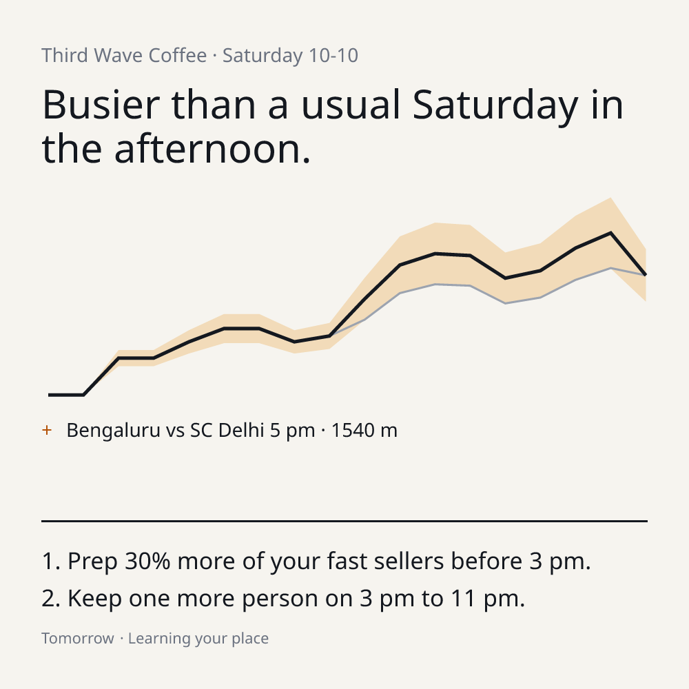
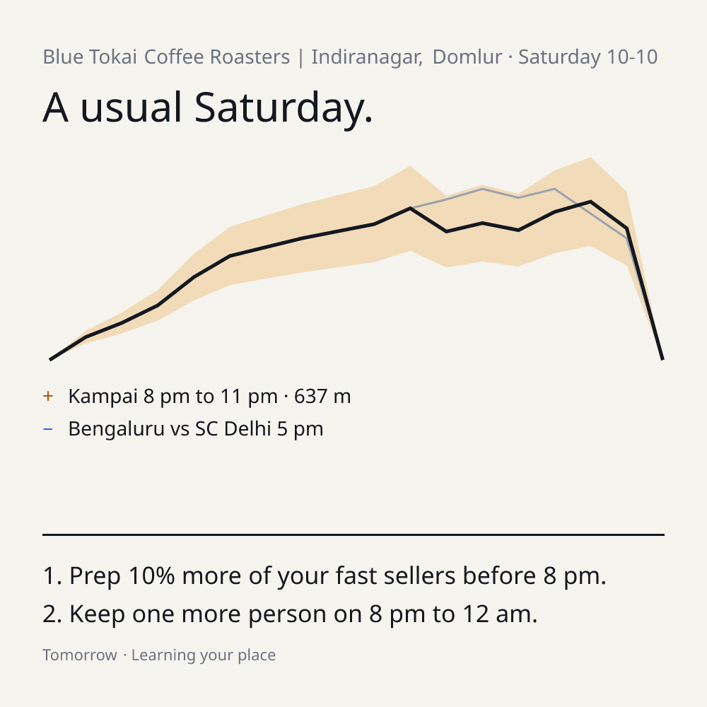

# Tomorrow

A nightly demand forecast for independent cafés, restaurants, bars and shops, written like a weather report: how busy tomorrow will be, why, and the two things to do about it. No POS, no sales history. Setup is picking your business from Google Maps.

Built for the SerpApi India Hackathon 2026 (Commerce & Market Intelligence).

> **Disclosure:** this project is new, built for the hackathon, and was built with Claude Code.

## Two cafés, same night

Saturday 10 Oct 2026: Bengaluru FC host SC Delhi (ISL) at Sree Kanteerava Stadium, 5 pm. Both cards below are built from live SerpApi responses.

| Third Wave Coffee, Church St (1.5 km from the stadium) | Blue Tokai, Indiranagar (about 5 km away) |
| --- | --- |
|  |  |

Third Wave gets a stadium pin and reads busier through the afternoon and evening. Blue Tokai only sees the match as a TV match (people stay home) plus a small event nearby, so the day stays usual.

## What it does

- **Onboarding:** search your business, see your own usual weekday curve (Google popular times), confirm archetype, area type, radius and leagues.
- **Evening card:** one-sentence headline, your usual day as a thin line, tomorrow as a band (wider = less sure), pins with source and distance, two actions.
- **Morning tap:** quieter / as expected / busier. One tap retrains the weights for that place.
- **Week strip:** seven days, one word per day part.
- **Share to staff:** the card as a 1000×1000 PNG for the WhatsApp group (`/api/share`).

## The six SerpApi calls

| Signal | Call | Cache |
| --- | --- | --- |
| Weekly rhythm | `engine=google_maps`, `place_id` | per place |
| Nearby anchors | `engine=google_maps`, `type=search`, `q=stadium/college/mall/event venue`, `ll=@lat,lng,14z` | per place |
| Local events | `engine=google`, `q=events this week`, `location=<canonical city>` (`events_results`; `google_events` is deprecated and blocked in `lib/serp.ts`) | city, daily |
| Matches | `engine=google_sports`, `type=league`, `tab=gm`, `sp=cr` (falls back to `ft`), `kgmid`, `moa`/`mob` as ISO8601 UTC (8-day window) | league, daily |
| Weather | `engine=google`, `q=weather tomorrow <city>` (`answer_box.hourly_forecast`) | city, twice daily |
| Disruptions | `engine=google_news`, `q=<city> road closure OR strike OR bandh` | city, daily |

Notes from real responses (raw files are in `fixtures/`):

- `events in <city>` returns no `events_results`; `events this week` does. Google's events block also comes and goes between identical requests, so the fetcher tries a second phrasing and never caches an empty result.
- `location` must be SerpApi's canonical name ("London,England,United Kingdom"). A bare "London" returns UK-wide events. `lib/location.ts` resolves it with the free Locations API.
- `google_sports` takes `moa`/`mob` as ISO8601 UTC strings, not epoch seconds. `sp=cr` works for ISL, `ft` or `cr` for ICC; both are tried. Venues come back as `{name, location: "<city>"}` (no coordinates), so a stadium match is recognised by matching the venue name to a stadium anchor.
- Match pins for TV only count when a team name contains the place's country or city, so a qualifier between two foreign sides moves nothing.
- News headlines are dropped unless they are under 48 hours old, and also when the title names a different day ("August 13", "on Thursday", "tomorrow" read from the publish date): stories get republished, so a fresh timestamp is not enough. City-wide words (bandh, strike, curfew, shutdown) get the full effect, a disruption near you 70%, and a protest elsewhere in the city whose venue the headline doesn't give 35%.

Events carry an address rather than coordinates, so each event venue is resolved with one cached Google Maps search to get its distance and a review-count size proxy.

**Weather:** the SerpApi answer box returns about 250 hourly rows (`hourly_forecast`) and is used first. If it is missing or thin, weather falls back to [Open-Meteo](https://open-meteo.com/) (free, not SerpApi). Open-Meteo is also used to look up the place's timezone. The rain pin shows which source it came from.

**Holidays** come from the `date-holidays` library, not search credits.

## India-specific factors

The model is built for India first. Besides the six SerpApi calls, these signals need no search credits:

| Signal | What it does | Evidence and status |
| --- | --- | --- |
| **Festival calendar** (`config/india-calendar.json`) | Navratri, Garba, Durga Puja, Dussehra, Karva Chauth, Dhanteras, Diwali night, Bhai Dooj, Chhath, Christmas, New Year's Eve, Pitru Paksha. Effects differ by archetype and fire by state (Durga Puja only in the east, Karva Chauth in the north, Garba in Gujarat and Maharashtra). Each entry carries a one-line note on how the festival is observed. | Dates cross-checked across several panchang sources. Directions are partly reported (Diwali week is the biggest revenue window; some restaurants report +30-40% on Diwali and Christmas) and mostly assumed. Each entry says which. |
| **Payday** | Salaried India is paid around the 1st to 7th: full effect on days 1-3, half on 4-7, a boost on weekends up to the 10th, and a small dip from the 26th. Office areas respond more than residential ones. | **No solid dining study found.** Small starting guesses that morning taps and owner weights tune. |
| **Air quality** | Open-Meteo hourly PM2.5, mapped to India's CPCB categories (poor, very poor, severe), cuts street-facing footfall; delivery kitchens gain. | A Delhi study (Blue Sky Analytics and Near, 2019-20) found footfall in Connaught Place, Karol Bagh and Lodhi Gardens fell up to 33% as PM2.5 rose. The strongest evidence in the model. |
| **How widely a festival is kept** (`observance` in the calendar) | Each festival's effect is scaled by state or city, 0 to 1.5. Pitru Paksha is full strength in Bihar and Varanasi and 15% in Delhi and Bengaluru; Navratri's bar dip is full in Gujarat and 30% in Bengaluru; Christmas runs 1.5x in Goa. The pin says when an effect was scaled down. | Assumed, not measured. City entries beat state entries. |
| **Drinking culture** (`config/india-culture.json`) | Each state or city is dry, low, medium or high. In pub cities (Bengaluru, Mumbai, Delhi, Goa...) bars get 25% bigger match, payday and event boosts and 40% smaller festival dips. In dry states (Gujarat, Bihar, Nagaland, Mizoram) dry days and festival abstinence are dropped and bar boosts are halved; onboarding suggests Restaurant or Café there. | Assumed. Scales signals only: the popular-times curve already shows how busy the area normally is. |
| **Dry days** | National dry days (26 Jan, 15 Aug, 2 Oct) cut bars hard and restaurants a little. State and election dry days arrive through the news signal. | Dates are fixed; magnitudes are guesses. |
| **Public holidays** | `date-holidays` has only 6 public holidays for India and lacks Dussehra and Christmas Day; the calendar fills those in. | Verified against the library. |

Cultural spending patterns shape the archetype columns: alcohol and non-veg are avoided in Navratri and Pitru Paksha (bars down, restaurants up in the evenings); couples dine out on Karva Chauth; families stay home on Diwali night and go out in the days either side; shopping peaks before Dhanteras.

TV matches are calibrated from IPL 2026 data (Swiggy reported dineout bookings up 41% and delivery up 32% year on year, platform PR so indicative): restaurants lean positive, cafés only slightly negative.

All magnitudes are starting guesses in `config/effects.json` and `config/india-calendar.json`. Owners can turn any signal up or down from the pin's "why" sheet, and the morning tap tunes the rest. A per-hour cap (0.3x to 2.5x) stops stacked signals from producing absurd forecasts.

## Forecast model (v1, rules, no ML)

`F(h) = B(h) × Π (1 + wᵢ · eᵢ(h))` in `lib/forecast.ts`.

- `B(h)`: your own popular-times curve for tomorrow's weekday. If Google has none, the average of the 3 nearest same-type places, labelled "Based on places like yours".
- `eᵢ(h)`: from `config/effects.json` (one entry per archetype, editable), scaled linearly by distance to zero at your radius (stadium matches keep full effect out to 75% of the radius first), and by venue size for events.
- `wᵢ`: per-place weight, starts at 1.0. Morning tap: `w ← w + 0.2 × tap × sign(e)`, clamped to 0..2. "Tuned to your place" after 7 taps.
- Buckets per day part: below −15% quieter, to +15% usual, to +40% busier, above that much busier.
- Band width grows with opposing signals that overlap in time and shrinks as taps accumulate.
- An LLM only phrases the headline and two actions from the computed buckets and pins, and classifies news headlines as relevant or not. It uses Claude (`claude-haiku-4-5`) if `ANTHROPIC_API_KEY` is set, otherwise Gemini if `GEMINI_API_KEY` is set. With neither key, or if the call fails, deterministic rule-based copy is used.

## Setup

```bash
npm install
cp .env.example .env.local   # fill in the keys
```

1. Create a Supabase project and run `supabase/schema.sql` in the SQL editor (it is safe to re-run; it adds `weights.owner_set`, `places.area` and `places.state`, which the app tolerates being missing but needs for owner weights, local news and regional festivals) (choose "Run and enable RLS"). Tables have RLS on with no policies, so only the server-side secret key can read them; the file also grants `service_role` access, which is needed when "Automatically expose new tables" is off.
2. Set `SERPAPI_API_KEY`, `SUPABASE_URL`, `SUPABASE_SERVICE_ROLE_KEY` (the new-style `sb_secret_...` key works), `CRON_SECRET`, and optionally `ANTHROPIC_API_KEY` or `GEMINI_API_KEY`. Put each variable on its own line.
3. `LEAGUE_KGMIDS` is `Name:kgmid,Name:kgmid`. Verified: `ICC:/m/021q23` (international cricket, includes India's matches) and `ISL:/m/0ynr_sq` (Indian Super League). There is no verified IPL id yet; find it in season (search the league with `engine=google` and read `sports_results`, or open a game with `engine=google_sports&type=game` and read `game_results.info.league.kgmid`).
4. **Day-1 fixtures:** `npm run fixtures -- "<business name and area>"` calls every endpoint for a real place and saves raw JSON under `fixtures/`. Run it for a café near M. Chinnaswamy Stadium, a residential café, and one abroad.
5. `npm run dev`, open `/`, and onboard a business.
6. Deploy to Vercel. `vercel.json` runs `/api/cron` hourly; it builds the card for every place whose local time is 18:00. Test it any time with `/api/cron?force=1`.

```bash
npm test        # forecast maths, learning rule, parsers
npm run typecheck
```

## Known limits

- Run live on real places in Bengaluru, Delhi and London only.
- Not yet modelled: long weekends and bridge days, the academic calendar and exam weeks, state and election dry days (only via news), sub-regional festivals (Onam, Pongal, Ganesh Chaturthi) outside Oct 2026 to Jan 2027.
- The effect sizes, event-size buckets, band width and holiday effects are hand-set guesses; the morning tap tunes them per place.
- Google returns about 10 events per query, so a busy day can have events we never see.
- The week strip builds seven days on demand (about 4 s warm).
- Supabase has no auth and no per-user policies. The app remembers the owner's place in `localStorage`; fine for a hackathon, not for production.

## Not built yet

- Push or WhatsApp delivery at 7 pm. The cron prepares the card at 18:00 local; the owner opens the PWA to read it.
- Auth. The app remembers the owner's place in `localStorage` on one device.
- The optional "which part of the day" on the morning tap (the column exists in `taps.daypart`; the UI doesn't send it).
